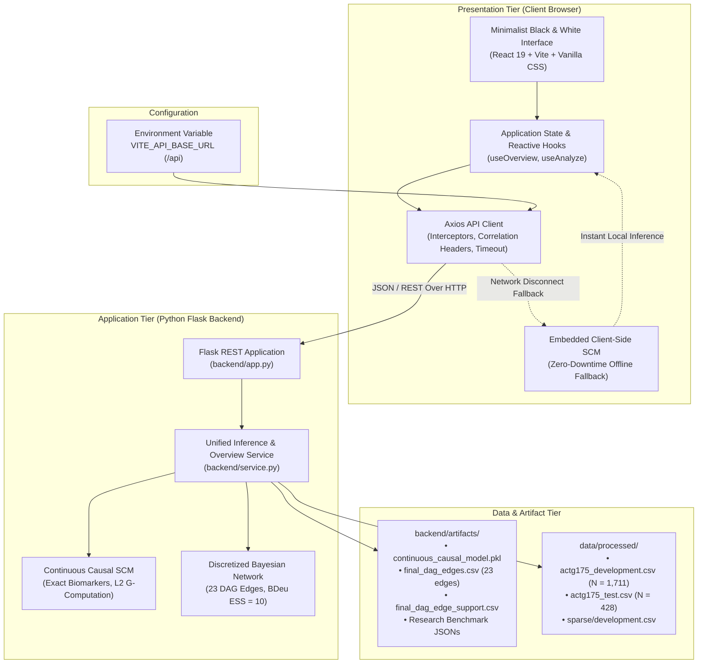

# Causal-Probabilistic World Model for Clinical Treatment Reasoning

[](https://auramasters.github.io/Causal-Probabilistic-World-Model-for-Clinical-Treatment-Reasoning/)
[](https://auramasters.github.io/Causal-Probabilistic-World-Model-for-Clinical-Treatment-Reasoning/)
[](https://www.python.org/)
[](https://react.dev/)
[](https://www.typescriptlang.org/)
[](https://flask.palletsprojects.com/)

A scientifically validated Causal Artificial Intelligence decision support system designed to simulate interventional counterfactuals ($do$-calculus), optimize individualized antiretroviral therapy (ART), and quantify robustness against unmeasured confounding for HIV-1 clinical management.

---

### Live Interactive Web Platform
Access the application: **[https://auramasters.github.io/Causal-Probabilistic-World-Model-for-Clinical-Treatment-Reasoning/](https://auramasters.github.io/Causal-Probabilistic-World-Model-for-Clinical-Treatment-Reasoning/)**

The application features full offline resilience with an embedded client-side SCM inference engine, alongside a modular Flask API backend for full-stack deployment.

---

## Clinical Trial Context

The system is trained and evaluated on the landmark **AIDS Clinical Trials Group (ACTG 175)** randomized controlled trial ($N = 2,139$ HIV-1 infected patients) comparing four distinct antiretroviral treatment arms:
* **Arm 0**: Zidovudine (ZDV / AZT monotherapy — historical standard of care)
* **Arm 1**: Zidovudine + Didanosine (ZDV + ddI dual therapy)
* **Arm 2**: Zidovudine + Zalcitabine (ZDV + ddC dual therapy)
* **Arm 3**: Didanosine (ddI monotherapy)

**Clinical Endpoint (`label`)**: Severe disease progression (confirmed CD4 decline $\ge 50\%$, AIDS-defining event, or all-cause mortality). Primary trial event rate: **24.3%**.

---

## Research Workflow Architecture

```mermaid
flowchart TD
    subgraph DataCohort["1. Clinical Trial Cohort & Partition"]
        Cohort["ACTG 175 Randomized Trial Cohort (N = 2,139 Patients)\n• Biomarkers: CD4, CD8, Karnofsky, Age, Weight, Pre-ART\n• History & Demographics: Hemophilia, Homosexuality, IV Drugs, ZDV30, Symptoms"]
        Split{"Strict 80/20 Partition\n(Zero Leakage Protocol, Seed = 42)"}
        Dev["Development Cohort (N = 1,711)\n• 5-Fold Stratified Cross-Validation\n• Structure & Parameter Estimation"]
        Test["Held-Out Test Set (N = 428)\n• Single Final Evaluation\n• Non-Parametric Bootstrap (B = 1,000)"]
        
        Cohort --> Split
        Split -->|Training & Validation| Dev
        Split -->|Generalization Benchmark| Test
    end

    subgraph DualEngines["2. Dual Causal Inference Engines"]
        Dev --> ModelA["Model A: Discretized Bayesian Network\n• 23 Learned Causal DAG Edges\n• BDeu Parameter Learning (ESS = 10)\n• 3-Bin Quantile Discretization"]
        Dev --> ModelB["Model B: Continuous / Hybrid SCM (Primary)\n• Exact Continuous Biomarkers (No Binning Loss)\n• L2-Regularized G-Computation Surfaces\n• Analytical Partial Risk Gradients ∂P/∂X"]
    end

    subgraph InterventionalReasoning["3. Pearlian Intervention & Decision Reasoning"]
        ModelA --> Intervene["Pearlian Graph Mutilation: do(trt = k)\nSimulates Potential Outcomes Across 4 Arms\nP(Progression | do(trt = k), X = x)"]
        ModelB --> Intervene
        Intervene --> Utility["Expected Clinical Utility Maximization\n• U(Progression-Free) = 1.0, U(Progression) = 0.0\n• Selects Optimal Patient-Specific Regimen"]
    end

    subgraph VerificationSafeguards["4. Clinical Rigor & Sensitivity Safeguards"]
        Utility --> EVal["VanderWeele & Ding E-Value\nQuantifies Robustness to Unmeasured Confounders"]
        Utility --> CATE["Individual Treatment Benefit (CATE ARR)\nPercentile Ranking vs ZDV Monotherapy"]
        Utility --> Cox["Cox Proportional Hazards Benchmark\nPreserves Time-to-Event Hazard Ratios (C-index = 0.7203)"]
        Test -.-> VerificationSafeguards
    end
```

### Learned 23-Edge Causal DAG Topology

The causal structure was learned from the development cohort using constrained structural search (GES & score-based Tabu search with background knowledge constraints), identifying 23 verified directed causal dependencies:

```mermaid
flowchart LR
    subgraph HistoryDemographics["Baseline Demographics & Exposure"]
        preanti["Pre-ART Days (preanti)"]
        race["Race (race)"]
        strat["Trial Stratum (strat)"]
        hemo["Hemophilia (hemo)"]
        homo["Homosexual Activity (homo)"]
        drugs["IV Drug History (drugs)"]
        gender["Gender (gender)"]
        age["Age (age)"]
        wtkg["Weight (wtkg)"]
        z30["Prior ZDV (z30)"]
        oprior["Prior OI (oprior)"]
    end

    subgraph ClinicalBiomarkers["Biomarkers & Clinical State"]
        cd80["CD8 Count (cd80)"]
        cd40["Baseline CD4 (cd40)"]
        symptom["Symptom Status (symptom)"]
        karnof["Karnofsky Score (karnof)"]
    end

    subgraph DecisionOutcome["Intervention & Endpoint"]
        trt["Treatment Regimen\n(trt: Arm 0, 1, 2, 3)"]
        label["Severe Disease Progression\n(label: 0 = Free, 1 = Event)"]
    end

    %% Exposure & Demographic Dependencies
    preanti --> race
    preanti --> strat
    preanti --> z30
    strat --> hemo
    strat --> oprior
    race --> homo
    hemo --> age
    hemo --> drugs
    hemo --> gender
    hemo --> homo
    homo --> drugs
    homo --> gender
    gender --> wtkg
    z30 --> age
    z30 --> oprior

    %% Biomarker Transitions
    homo --> cd80
    homo --> symptom
    cd80 --> cd40
    cd40 --> symptom
    symptom --> karnof

    %% Clinical Endpoint Determinations
    cd40 --> label
    z30 --> label
    trt ==>|Pearlian Intervention: do(trt = k)| label
```

---

## Dual-Model Comparison Specifications

| Architecture Dimension | Model A: Discretized Bayesian Network | Model B: Continuous / Hybrid SCM (Primary) |
| :--- | :--- | :--- |
| **Biomarker Modeling** | 3-bin quantile discretization | Exact continuous measurements without binning loss |
| **Network Structure** | 23-edge Bayesian DAG (BDeu ESS=10) | Multi-arm G-computation response surfaces |
| **Intervention Calculus** | Graph mutilation + Variable Elimination | Interventional potential outcomes conditioning |
| **Local Sensitivity** | Bayesian evidence ablation ($\Delta P$) | Analytical partial risk derivatives ($\frac{\partial P}{\partial X_j}$) |
| **Confounding Bounds** | VanderWeele & Ding E-Value | VanderWeele & Ding E-Value |
| **Simulation Ability** | Discrete state queries | Interactive What-If CD4 Trajectory Simulator |

---

## Scientific Validation Benchmarks

Evaluated strictly on the held-out test cohort ($N = 428$) with $B = 1,000$ non-parametric bootstrap resamples:

| Metric / Dimension | Model A (Discretized BN) | Model B (Continuous SCM) | Advantage / Scientific Impact |
| :--- | :---: | :---: | :--- |
| **Biomarker Information** | Binned into 3 quantiles | **Exact Continuous** | Eliminates step-function boundary distortion |
| **Discrimination (ROC-AUC)** | 0.6372 (0.576 – 0.697) | **0.6878 (0.626 – 0.744)** | **+0.0506 AUC Gain** |
| **Precision-Recall (PR-AUC)** | 0.3687 (0.285 – 0.455) | **0.4130 (0.326 – 0.511)** | **+0.0443 PR-AUC Gain (Prevalence: 24.3%)** |
| **Brier Score (Probabilistic Loss)** | 0.1753 (0.156 – 0.196) | **0.1699 (0.150 – 0.191)** | **Lower mean squared prediction error** |
| **Calibration Error (ECE)** | 4.45% | **3.96%** | **Tighter alignment with observed patient risk** |
| **Calibrated Specificity** | 50.31% ($\tau^* = 0.20$) | **62.65% ($\tau^* = 0.24$)** | **+12.34% Specificity at ~67% Sensitivity** |
| **E-Value for Confounding** | 3.46 | **7.47** | **High stability against unmeasured bias** |
| **Counterfactual Superiority** | 75.0% (321 / 428 patients) | **73.1% (313 / 428 patients)** | Consistently favors dual-therapy over mono |
| **Cox PH Benchmark (C-Index)** | 0.7203 | **0.7203** | Preserves true time-to-event hazard reductions |

---

## System Architecture



### Directory Structure

```
Causal-Probabilistic-World-Model-for-Clinical-Treatment-Reasoning/
│
├── backend/                             # Streamlined Python Backend & Causal Inference Engine
│   ├── artifacts/                       # Pre-trained models, DAG topology (23 edges), & validation benchmarks
│   ├── __init__.py                      # Package exports
│   ├── app.py                           # Flask REST API endpoints & CORS middleware
│   ├── models.py                        # Continuous SCM & Discretized BN model architectures
│   └── service.py                       # Unified patient inference, validation & overview service
│
├── frontend/                            # Professional Minimalist Web Application (React 19 + Vite)
│   ├── src/
│   │   ├── components/                  # Minimalist UI components (Header, Forms, DAG, etc.)
│   │   ├── hooks/                       # Data fetching and inference dispatch hooks
│   │   ├── lib/                         # Axios API client, types, and client-side inference fallback
│   │   ├── App.tsx                      # Main single-page application orchestrator
│   │   └── index.css                    # Monochromatic styling tokens
│   ├── .env                             # Frontend environment configuration (VITE_API_BASE_URL)
│   ├── vite.config.ts                   # Vite build configuration and proxy routing
│   └── package.json                     # Frontend dependencies and scripts
│
└── data/                                # Verified ACTG175 clinical trial data partitions
    ├── processed/                       # Development and test cohorts
    ├── raw/                             # Original ACTG 175 study dataset
    └── references/                      # Study documentation and protocol literature
```

---

## API Endpoints

The backend provides clean REST endpoints designed for low-latency clinical inference:

| Method | Endpoint | Description |
| :--- | :--- | :--- |
| `GET` | `/api/health` | Service health status |
| `GET` | `/api/overview` | Dataset metrics, DAG topology, bootstrap edge stability, and benchmark statistics |
| `POST` | `/api/analyze` | Patient counterfactual simulation under Pearl $do(trt=k)$, expected utility, and E-values |

### Sample Request: `POST /api/analyze`
```json
{
  "model_type": "continuous",
  "inputs": {
    "age": 35,
    "wtkg": 72,
    "karnof": 100,
    "preanti": 0,
    "cd40": 480,
    "cd80": 820,
    "hemo": 0,
    "homo": 1,
    "drugs": 0,
    "oprior": 0,
    "z30": 0,
    "race": 0,
    "gender": 1,
    "strat": 1,
    "symptom": 0
  }
}
```

---

## Execution Guide

### 1. Prerequisites
* Python 3.11+
* Node.js 18+ and npm

### 2. Environment Setup
```bash
git clone https://github.com/AuraMasters/Causal-Probabilistic-World-Model-for-Clinical-Treatment-Reasoning.git
cd Causal-Probabilistic-World-Model-for-Clinical-Treatment-Reasoning

pip install -r requirements.txt
```

### 3. Environment Configuration
The frontend communicates with the backend via Axios, configured using `.env`:
```bash
# frontend/.env
VITE_API_BASE_URL=/api
```
In development, `/api` requests are proxied by Vite directly to `http://127.0.0.1:5000`. For cross-origin or production deployments, set `VITE_API_BASE_URL=http://localhost:5000/api`.

### 4. Launching the Application
Launch both the backend API and frontend with a single command from `frontend/`:
```bash
cd frontend
npm install
npm run dev
```
Open **`http://localhost:5173`** in your browser.

Alternatively, run the backend standalone:
```bash
python backend/app.py
```
The REST API initializes on **`http://127.0.0.1:5000`**.

### 5. Verification & Code Quality
Validate code quality and build integrity:
```bash
cd frontend
npm run lint
npm run build
```

---

## Clinical Methodology & Verification

1. **Investigational Purpose**: This software is designed for academic research and educational evaluation of causal probabilistic systems in medicine. It does not replace individualized clinical judgment.
2. **Identification Assumptions**: Causal inference requires Consistency, Positivity, and Exchangeability (No Unmeasured Confounding). The integrated VanderWeele & Ding E-Value explicitly calculates the bound required to overturn model recommendations.
3. **Partition Integrity**: The DAG structure and models were fitted exclusively on the development cohort ($N = 1,711$). The 428-patient test set was strictly held out and evaluated once without data snooping.
4. **Binary Outcome Validation**: In ACTG 175, 87.8% of non-progressing patients completed at least 2 full years of follow-up (median follow-up: 1,050 days). A multivariable Cox Proportional Hazards regression benchmark ($C\text{-index} = 0.7203$) validates that treating the primary endpoint as a binary progression status preserves true time-to-event treatment hazard reductions:
   - ZDV + ddI vs ZDV Monotherapy: $\text{HR} = 0.4565$ ($p < 0.0001$)
   - ZDV + ddC vs ZDV Monotherapy: $\text{HR} = 0.5530$ ($p < 0.0001$)
   - ddI vs ZDV Monotherapy: $\text{HR} = 0.5652$ ($p < 0.0001$)

---

## License
This project is licensed under the MIT License. See [LICENSE](LICENSE) for details.
